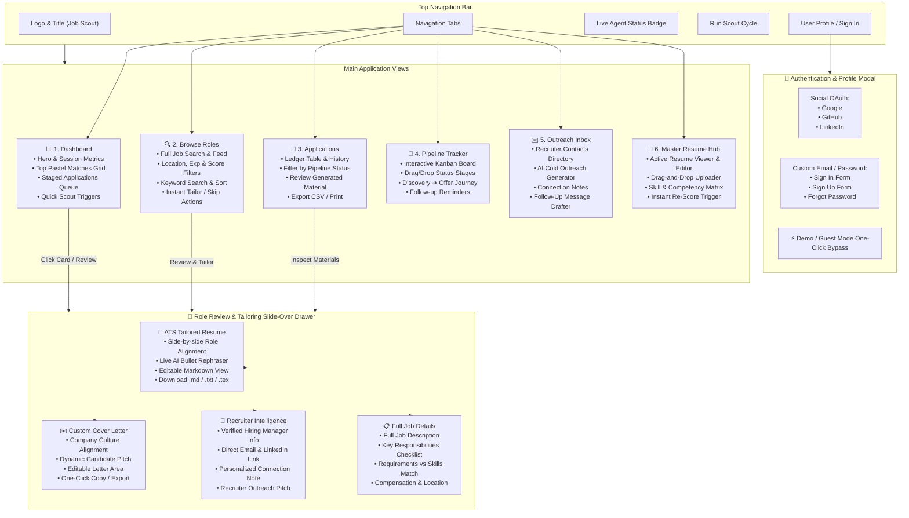

# 🎯 Job Scout Agent · Intelligent Career Navigator & ATS Suite

[](https://python.org)
[](https://tailwindcss.com)
[](https://streamlit.io)
[](https://apify.com)
[](https://supabase.com)
[](https://github.com/swapniljathar/job_scout_agent)

> **Job Scout Agent** is a privacy-first, human-in-the-loop autonomous job discovery and application tailoring platform. It automates high-match role scouting from LinkedIn, calculates multi-dimensional ATS fit scores against your master profile, and generates bespoke, editable resumes, cover letters, and recruiter outreach messages.

---

## 🗺️ Complete Website & Application Map

The Job Scout Agent interface is designed with a soothing, distraction-free neutral aesthetic (soft whites, light greys, pastel accent cards) and an intuitive, tabbed architecture with an interactive slide-over review drawer.

### 1. Visual Site Architecture



---

### 2. Comprehensive Screen & Component Directory

| View / Component | Route / ID | Key Purpose | Primary Actions & Controls |
| :--- | :--- | :--- | :--- |
| **Global Header** | `<header>` | Persistent app navigation, session status, user state | • View switch buttons<br>• `Run Scout Cycle` crawler trigger<br>• Profile / Auth modal launcher |
| **1. Dashboard** | `#tab-dashboard` | Mission control center showing daily match metrics and top opportunities | • Metric counters (Matches, High Fit $\ge 85\%$, Staged, Applied)<br>• 5 Pastel Highlight Cards with radial gauge rings<br>• Staged applications quick review list<br>• One-click batch approval |
| **2. Browse Roles** | `#tab-browse` | Deep exploration of all ingested job postings | • Live search query filter<br>• Location & minimum score slider<br>• Sort by Match Score, Date, or Company<br>• Job card actions: *Review & Tailor*, *Apply Direct*, *Skip* |
| **3. Applications** | `#tab-applications` | Structured database ledger tracking every application | • Filterable table (Staged, Applied, Interview, Offer, Rejected)<br>• Direct links to generated resume files<br>• Status transition dropdowns<br>• Date applied and notes logger |
| **4. Pipeline Tracker** | `#tab-tracker` | Visual multi-stage Kanban workflow of your active pipeline | • Columns: *Discovered* ➔ *Staged* ➔ *Applied* ➔ *Interview* ➔ *Offer*<br>• Card movement across columns<br>• Urgent deadline tags and follow-up indicators |
| **5. Outreach Inbox** | `#tab-inbox` | Recruiter contact database and messaging studio | • Contact cards with verified email, title, and LinkedIn<br>• One-click tailored LinkedIn connection note generator<br>• Cold email outreach copy button<br>• Post-interview follow-up drafter |
| **6. Master Resume Hub** | `#tab-resume` | Core profile management and benchmark skills editor | • Multi-format resume uploader (`.pdf`, `.docx`, `.md`, `.txt`)<br>• In-browser Markdown resume editor with live word count<br>• Skills & competencies tag manager<br>• *Save & Trigger Re-Score* across all active jobs |
| **Review Slide-Over Drawer** | `#role-drawer` | **Human-in-the-Loop** inspection and tailoring hub | • Drawer Sub-tabs (`Resume`, `Cover Letter`, `Recruiter Intel`, `Job Details`)<br>• In-line text editor for tailored resume bullets<br>• In-line cover letter editor<br>• Formats: Download `.md`, `.txt`, `.tex`, `.pdf`<br>• `Approve & Mark Applied` button |
| **Auth & Profile Modal** | `#auth-modal` | User sign-in, registration, and session control | • Google, GitHub, and LinkedIn OAuth sign-in<br>• Custom email & password registration and login<br>• Instant Demo/Guest account login<br>• Password recovery modal |

---

### 3. Core User Journeys

#### A. Role Discovery & Autonomous Scoring
1. **Scout Ingestion**: The system queries LinkedIn via Apify (`curious_coder/linkedin-jobs-scraper`) or loads the cached offline feed.
2. **ATS Scoring Engine**:
   - **Title Alignment (40%)**: Role keyword matching against your target title.
   - **Core Competencies (40%)**: Skill extraction (e.g. AI/ML, Python, System Architecture, Agile).
   - **Seniority & Stability (20%)**: Experience level match and company health check.
3. **Card Display**: Evaluated roles appear in the **Dashboard** and **Browse** feed with radial score indicators and color-coded badges.

#### B. Human-in-the-Loop Tailoring & Application
1. **Open Review**: Click **Review & Tailor** on any high-scoring job card to slide open `#role-drawer`.
2. **Resume Inspection (`#dtab-content-resume`)**:
   - Review AI-targeted bullet points emphasizing skills required by the employer.
   - Edit the tailored resume directly in the text editor.
   - Use the **AI Rephrase** tool to rewrite specific bullets for maximum impact.
3. **Cover Letter Generation (`#dtab-content-cover`)**:
   - Read the auto-generated cover letter addressing the hiring team and referencing role specifics.
   - Edit tone, length, and personal notes.
4. **Recruiter Outreach (`#dtab-content-lusha`)**:
   - View identified hiring managers and recruiters.
   - Copy a pre-crafted 300-character LinkedIn connection note or formal email.
5. **Finalize**: Click **Approve & Mark Applied** to advance the role to the **Applications** ledger and **Pipeline Tracker**.

#### C. Updating Master Profile & Dynamic Re-Scoring
1. Navigate to **Master Resume Hub** (`#tab-resume`).
2. Upload a new resume or edit your Markdown in the editor.
3. Click **Save & Re-Score All Roles**: The agent recalculates ATS fit scores for every active listing immediately.

---

## 🛠️ Dual-Interface System Architecture

Job Scout Agent provides two complementary interfaces:

1. **Modern Single-Page Application (SPA)** (`server.py` + `job-hunt-dashboard.html`):
   - Fast, zero-dependency Python HTTP server (`http://localhost:8080`).
   - Tailwind CSS design system with soothing light-grey/white tones.
   - Client-side state persistence in `localStorage` with optional Supabase Cloud sync.
   - Interactive slide-over drawers, modals, and recruiter contact cards.

2. **Streamlit Analytics Dashboard** (`app.py`):
   - Multi-tab Python data science application (`http://localhost:8501`).
   - Deep inspection of raw scraped JSON schemas, scoring formula weight adjustments, and direct LaTeX resume compilation.

---

## 📁 Repository Directory Structure

```text
job_scout_agent/
├── .env.example                # Sample environment variables template
├── .gitignore                  # Strict exclusion of private data (resumes, ledgers, keys)
├── README.md                   # Complete system documentation & sitemap
├── requirements.txt            # Python dependencies (Streamlit, Apify, Requests, etc.)
│
├── index.html                  # Root landing page routing to dashboard
├── job-hunt-dashboard.html     # Modern SPA Dashboard (Tabs, Modals, Drawer, ATS Editor)
├── favicon.svg                 # Custom Job Scout Agent browser tab favicon
├── server.py                   # Lightweight HTTP server with clean routing & MIME types
│
├── app.py                      # Full-featured Streamlit agent dashboard
├── pipeline.py                 # Core scraping, scoring, and resume generation pipeline
├── daily_job_scout.py          # Scheduled daily runner for crawling and scoring
├── sample_jobs.py              # Mock/offline job feed for instant testing
├── master_resume.template.md   # Generic placeholder resume template for new users
└── supabase_schema.sql         # SQL schema for cloud database & auth synchronization
```

---

## 🚀 Quickstart & Setup

### 1. Clone the Repository
```bash
git clone https://github.com/swapniljathar/job_scout_agent.git
cd job_scout_agent
```

### 2. Set Up Virtual Environment & Dependencies
```bash
python3 -m venv venv
source venv/bin/activate
pip install -r requirements.txt
```

### 3. Configure Environment Variables (Optional)
Copy `.env.example` to `.env` and fill in your API credentials:
```bash
cp .env.example .env
```
```env
APIFY_API_TOKEN=your_apify_api_token_here
SUPABASE_URL=https://your-project.supabase.co
SUPABASE_KEY=your_supabase_anon_key
PORT=8080
```

### 4. Create Your Local Master Resume
Copy the included template:
```bash
cp master_resume.template.md master_resume.md
```
Edit `master_resume.md` with your genuine experience and skills. *(Note: `master_resume.md` is strictly git-ignored and will never be pushed).*

### 5. Launch the Modern Web Dashboard
```bash
python3 server.py
```
Open your browser at **`http://localhost:8080`**.

### 6. (Alternative) Launch the Streamlit Dashboard
```bash
streamlit run app.py
```
Open your browser at **`http://localhost:8501`**.

---

## 🔒 Privacy & Secret Protection

Job Scout Agent is engineered from the ground up to protect your sensitive personal data:

- **Local Storage Isolation**: Your `master_resume.md`, generated PDF resumes (`resumes/`), and application history (`job_ledger.json`) are stored exclusively on your local machine.
- **Strict `.gitignore` Policy**: Private files, API keys, virtual environments, and LaTeX compilation artifacts are hardcoded into `.gitignore`.
- **Zero Leak Tracking**: Sanitized templates ([master_resume.template.md](master_resume.template.md)) and mock placeholders are used across all committed code.

---

## ☁️ Deployment Guide

| Platform | Deployment Method | Recommended Command / Setting |
| :--- | :--- | :--- |
| **Vercel** | Static Web App | Deploy `index.html` & `job-hunt-dashboard.html` using the static preset |
| **Firebase Hosting** | Firebase CLI | `firebase deploy --only hosting` (configure `public: "."`) |
| **Render / Railway** | Python Web Service | Start command: `python3 server.py` (binds to `PORT`) |
| **Streamlit Community Cloud** | Streamlit App | Connect GitHub repo and point entry to `app.py` |

---

## 📄 License

Distributed under the **MIT License**. Feel free to adapt and expand this agent for your own career search.
